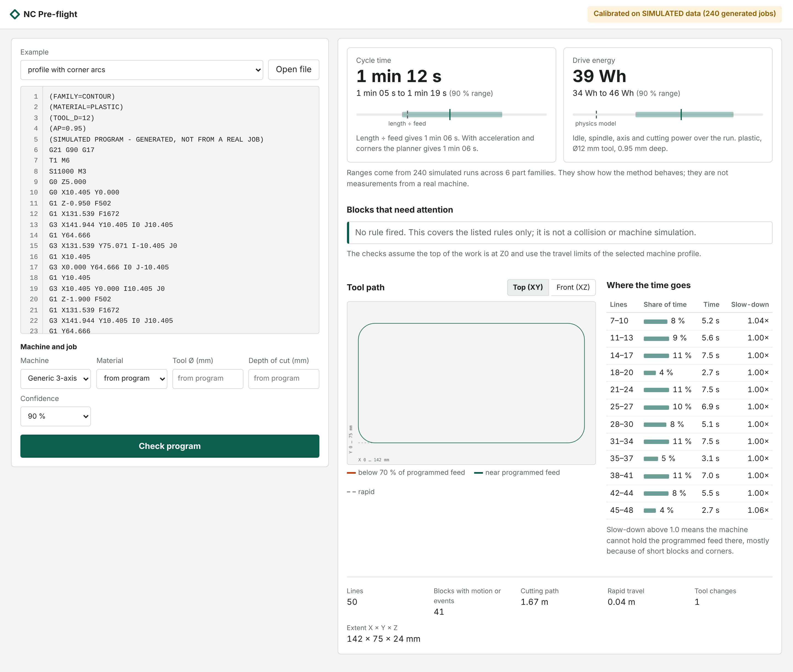

# NC Pre-flight

Check a 3-axis CNC program before it reaches the machine. You give it the NC program (G-code); it returns:

- **Cycle time as a range**, for example "1 min 05 s to 1 min 19 s, 90 % range", next to the naive length ÷ feed figure a CAM system reports.
- **Drive energy as a range.**
- **Blocks that need attention**: 15 deterministic rules and 7 parser notes, such as a rapid move into the work, a cutting move with the spindle off, or an arc that does not close.
- **Where the time goes**, by line range, and where the machine cannot hold the programmed feed.



## Status: prototype on simulated data

Every calibrated number this repository produces today comes from **simulated machines and generated programs**. The interface says so on every screen. No result here is evidence of accuracy on a real machine. A study on open measured data from two real machines is planned; see `docs/report.md` §9.

## Run it

```bash
pip install -r requirements.txt
uvicorn ncpreflight.api:app --port 8000
# open http://localhost:8000
```

Python 3.11 or newer. No database, no build step, no cloud service.

## Reproduce the experiment

```bash
python scripts/run_experiment.py --jobs 40 --seeds 3   # about 1.5 minutes
python -m pytest -q                                     # 79 tests
```

The script regenerates `results/sim_results.md`, `results/sim_results.json` and the calibration file `artifacts/calibration_generic-vmc.csv`.

## How it works

| Step | Module | What it does |
|---|---|---|
| Parse | `ncpreflight/gcode.py` | ISO G-code for 3-axis milling into segments with modal state. Unsupported codes are reported, never guessed. |
| Plan | `ncpreflight/planner.py` | Look-ahead trapezoidal velocity planner with corner slow-down. Gives the physics-based time. |
| Energy | `ncpreflight/energy.py` | Idle + spindle + axis + cutting power over the planned times. |
| Check | `ncpreflight/checks.py` | Rule-based program checks. |
| Calibrate | `ncpreflight/calibration.py` | Learns log(measured ÷ baseline) from logged runs and builds conformal prediction intervals. Flags programs unlike the calibration jobs. |
| Serve | `ncpreflight/service.py`, `api.py`, `web/` | One `analyze` call, a small HTTP API, a static interface. |
| Simulate | `ncpreflight/simulate.py` | Simulated machines and generated programs, for testing the pipeline. |

Calibration data is a CSV with one row per logged job (`artifacts/calibration_<machine>.csv`). The model is rebuilt from that file at start-up, so there are no binary model files in the repository. Real logged runs use the same format.

## Limits

- 3-axis milling only. Canned cycles, cutter compensation and controller-specific cycles are flagged and left out of the estimate.
- The program checks are rules. They are not a collision check or a machine simulation.
- Ranges assume the new program resembles the calibration jobs. When it does not, the interface says the range is unreliable.
- "Energy" means drive energy as a controller would report it, not wall-plug consumption.

## Documents

- `docs/report.md` – technical report (PDF in `docs/report.pdf`)
- `docs/blueprint.md` – requirements, architecture, evaluation plan
- `docs/research/` – research brief, search log, literature matrix
- `results/sim_results.md` – experiment results
- `docs/presentation/NC-Preflight.pptx` – 15-slide explainer deck (built by `scripts/build_deck.js`)
- `docs/patent-draft.pdf` – the project written as a draft patent specification (not filed; see its §10 before publishing anything)

## Licence

MIT. See `LICENSE`.
